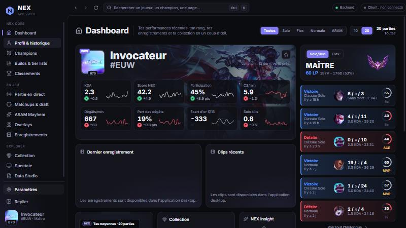
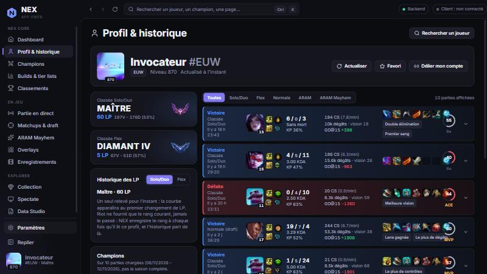
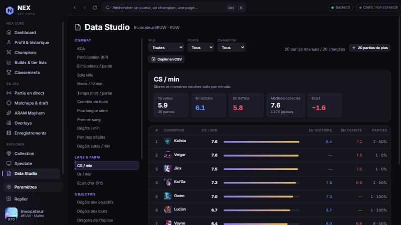

# NEX

Application compagnon League of Legends pour Windows. Elle rassemble l'historique de parties,
le détail de chaque partie, des statistiques descriptives et des overlays en jeu, à partir de
l'API Riot officielle.

Projet personnel, utilisé sur une seule machine. NEX n'est ni publié ni distribué.

## Ce que fait NEX

**Profil et historique.** L'historique du compte lié et de n'importe quel joueur cherché par
Riot ID. Chaque ligne porte son résultat, son KDA, ses objets, son écart d'or à 15 minutes, et
les distinctions de la partie (MVP, ACE, rang sur les dix joueurs, « Lane gagnée », « Meilleure
vision »…), calculées à partir des participants de la partie.

**Détail d'une partie.** Tableau des équipes avec objectifs et bannissements, page de runes et
ordre d'achat réel reconstitué depuis la timeline, courbes d'or et de CS, événements clés.

**Historique des LP.** L'API Riot ne renvoie que le rang courant. NEX relève le rang à chaque
lecture de profil et construit la courbe à partir de ses propres relevés : l'historique commence
au premier relevé, rien n'est reconstitué avant.

**Data Studio.** Un catalogue de 27 mesures (CS/min, participation, part des dégâts, temps mort,
contrôle de foule, dégâts aux objectifs, vision…). Pour chacune : ta valeur, ta valeur en
victoire et en défaite, le classement de tes champions, et la médiane des parties que NEX a
collectées lui-même.

**Champions, builds et matchups.** Fiches de champions, builds et runes les plus observés,
tier list et matchups — tous calculés sur les parties que NEX collecte, jamais importés d'un
autre site.

**Classements et joueurs pro.** Challenger, Grand Maître et Maître, et les comptes de joueurs
professionnels déclarés publiquement sur Leaguepedia.

**Overlays en jeu.** Chronomètre, timers d'objectifs, prochain objet et rappel de compétence,
construits uniquement à partir de la Live Client Data API et d'événements que la partie annonce
aux dix joueurs.

## Ce que NEX ne fait pas

- **Aucun classement parallèle.** Le « Score NEX » note une partie jouée (0–100, à partir du
  KDA, de la participation, des CS/min, de la part des dégâts et de la vision). Ce n'est pas une
  estimation de niveau, de MMR ou de rang caché : NEX n'en calcule aucune.
- **Aucune écriture non sollicitée dans le client League.** NEX lit l'historique local pour les
  parties qu'une API publique ne fournit pas. Il n'écrit dans le client que sur une action
  explicite : importer une page de runes, importer un set d'objets, lancer le mode spectateur.
- **Aucun avantage déloyal.** Pas de lecture de la mémoire du jeu, pas d'information cachée au
  joueur, pas d'action automatisée à sa place.
- **Aucune monétisation.** Gratuit, sans publicité, sans paiement, sans pari, sans cryptomonnaie.

## Comment NEX utilise l'API Riot

- Un backend local (Rust / axum) détient la clé API dans un fichier d'environnement côté
  serveur. La clé n'est jamais dans le code de l'interface ni dans un binaire distribué.
- Appels en HTTPS uniquement, vers `account-v1`, `summoner-v4`, `league-v4`, `match-v5`
  (parties et timelines) et `spectator-v5`.
- Un limiteur applicatif applique 20 requêtes/seconde et 100 requêtes/2 minutes **avant**
  chaque appel, respecte les réponses 429 et leur en-tête `Retry-After`, et attend au lieu de
  réessayer immédiatement.
- Les réponses sont mises en cache dans une base SQLite locale : les parties et les timelines
  sont immuables et conservées, le reste a une durée de vie courte.
- Aucune donnée n'est transmise à un tiers.

## Technique

Tauri 2 · Rust · React · TypeScript · SQLite.

### Prérequis

- Windows 10/11 avec WebView2
- Node.js 22+, Rust stable, Visual Studio Build Tools (C++)

### Commandes

| But | Commande |
| --- | --- |
| Installer les dépendances | `npm install` |
| Lancer le backend NEX (clé dans `backend/.env`) | `npm run backend` |
| Lancer l'app en développement | `npm run tauri dev` |
| Typage + tests TS + tests Rust (workspace) | `npm run check` |
| Exécutable release (sans installateur) | `npx tauri build --no-bundle` |
| Installateur Windows (NSIS, non signé) | `npx tauri build` |
| Mesurer la mémoire de NEX en cours d'exécution | `npm run measure` |
| Audit des dépendances (npm + RustSec, nécessite `cargo install cargo-audit`) | `npm run audit` |

L'installateur se trouve dans `target\release\bundle\nsis\NEX_0.1.0_x64-setup.exe`. Il installe
NEX pour l'utilisateur courant, sans droits administrateur, et accepte `/S` pour une
installation silencieuse. Il n'est pas signé : SmartScreen affichera un avertissement au
premier lancement.

### Configuration

`backend/.env` contient la clé Riot et n'est jamais versionné. Voir
[backend/README.md](backend/README.md).

### Documentation

- [Architecture](docs/ARCHITECTURE.md)
- [Méthode statistique](docs/METHODE_STATISTIQUE.md)
- [Performances](docs/PERFORMANCES.md)
- [ARAM Mayhem](docs/MAYHEM.md)

## Mention légale

NEX n'est ni approuvé ni sponsorisé par Riot Games et ne reflète pas les opinions de Riot Games
ou de toute personne officiellement impliquée dans la production ou la gestion des propriétés de
Riot Games. Riot Games et toutes les propriétés associées sont des marques commerciales ou
déposées de Riot Games, Inc.
